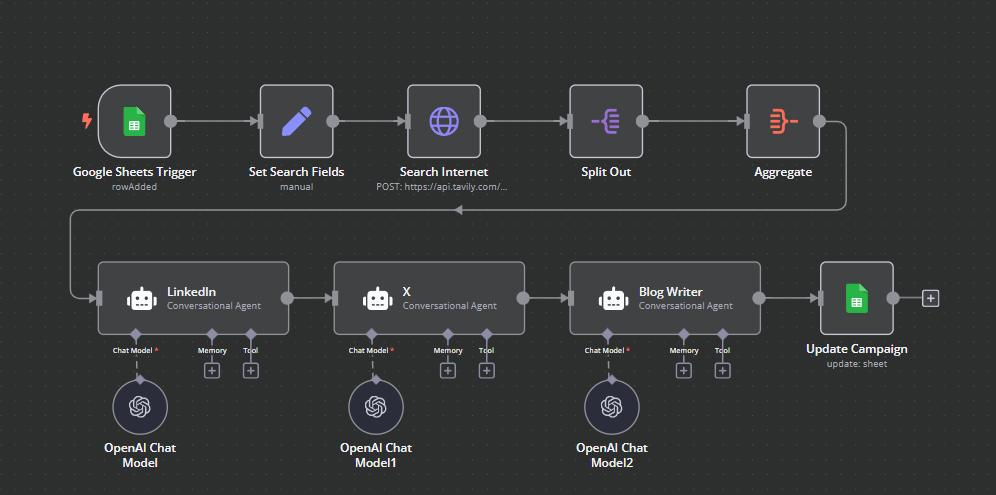
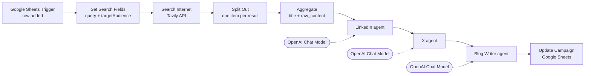

# Research and Content Creation Agent

An n8n workflow that turns one row in a Google Sheet into a researched, multi-platform content pack. You add a campaign with a subject and a target audience; the workflow searches the web for recent news on that subject, then three AI agents write a LinkedIn post, an X (Twitter) post and a short blog article, and the results are written back to the same row.



## What it does

1. **Watches a Google Sheet** for newly added rows (polled every minute).
2. **Researches the subject** with the [Tavily](https://tavily.com) search API, pulling the top 3 news results with their full article text.
3. **Condenses the research** into a single payload of article titles and bodies.
4. **Generates content** with three OpenAI-backed agents, each with its own system prompt:
   - **LinkedIn** – a mobile-friendly post with a call to action and 3–5 hashtags
   - **X** – a post within the 280-character limit with 1–3 hashtags
   - **Blog Writer** – a two-paragraph article
5. **Writes the three outputs back** to the originating row, matched on the campaign name.

## Architecture



The workflow has two stages:

| Stage | Nodes | Purpose |
| --- | --- | --- |
| Research | Google Sheets Trigger → Set Search Fields → Search Internet → Split Out → Aggregate | Turn a sheet row into a compact bundle of source articles |
| Content | LinkedIn → X → Blog Writer → Update Campaign | Write platform-specific content from that bundle and save it |

The three agents run one after another, but they do not build on each other's output. Each one reads the same research bundle from the `Aggregate` node and the same target audience from `Set Search Fields`. They are chained so that all three outputs are available to the final `Update Campaign` node in a single run.

A node-by-node walkthrough is in [docs/ARCHITECTURE.md](docs/ARCHITECTURE.md).

## Tech stack

| Component | Used for |
| --- | --- |
| [n8n](https://n8n.io) | Workflow orchestration |
| n8n AI Agent nodes (LangChain) | The three content agents |
| OpenAI Chat Model | LLM behind each agent |
| Tavily Search API | Web research |
| Google Sheets | Input form and output store |

## Repository structure

```
.
├── workflow/
│   └── multi_ai_agents.json          # The n8n workflow, ready to import
├── templates/
│   └── content_creation_sheet.csv    # Column layout for the Google Sheet
├── docs/
│   ├── ARCHITECTURE.md               # Node-by-node explanation and data flow
│   ├── SETUP.md                      # Step-by-step setup guide
│   └── PROMPTS.md                    # The agents' prompts and their design
├── assets/
│   └── workflow-canvas.jpeg          # Screenshot of the workflow in n8n
├── LICENSE
└── README.md
```

## Quick start

You need an n8n instance (cloud or self-hosted), an OpenAI API key, a Tavily API key and a Google account.

1. Create a Google Sheet with the columns in [`templates/content_creation_sheet.csv`](templates/content_creation_sheet.csv).
2. In n8n, choose **Import from File** and select [`workflow/multi_ai_agents.json`](workflow/multi_ai_agents.json).
3. Attach your OpenAI and Google Sheets credentials to the nodes that ask for them.
4. Point the `Google Sheets Trigger` and `Update Campaign` nodes at your sheet.
5. Replace `YOUR_TAVILY_API_KEY` in the `Search Internet` node.
6. Activate the workflow and add a row to the sheet.

Full instructions, including how to test without waiting for the trigger, are in [docs/SETUP.md](docs/SETUP.md).

## Using it

Add a row and fill in the first three columns. Leave the rest empty.

| Campaign | Content Subject | Target Audience | LinkedIn | X | Blog |
| --- | --- | --- | --- | --- | --- |
| AI in Healthcare – Q4 | AI diagnostics in hospitals | Hospital administrators | *(filled by workflow)* | *(filled by workflow)* | *(filled by workflow)* |

Within about a minute the trigger picks up the row, and the three content columns are filled in once the run completes.

`Campaign` is the key used to write results back, so each campaign name must be unique in the sheet.

## Design notes

- **Google Sheets as the interface.** A sheet works as both the input form and the output store, so non-technical users can run campaigns without opening n8n.
- **Research before writing.** The agents are given real, recent article text rather than relying on the model's training data, which keeps the content grounded in current news.
- **One agent per platform.** Each platform has its own system prompt with its own length, tone and formatting rules, plus a worked example. This gives more control than asking a single prompt for all three formats.
- **Split Out then Aggregate.** Tavily returns extra fields per result (URL, score, snippet). Splitting the results and re-aggregating only `title` and `raw_content` strips those out and gives the agents one clean item.

## Limitations and possible improvements

- **No error handling.** If Tavily or OpenAI fails, the run stops and the row is left unfilled. Error branches and retries would make it more robust.
- **Tavily key is stored in the node body** rather than in an n8n credential. Moving it to a credential or environment variable is safer.
- **Full article text is passed to all three agents**, which can be token-heavy for long articles. A summarisation step after `Aggregate` would cut cost.
- **Agents run sequentially.** Since they are independent, they could run in parallel and be merged before the sheet update.
- **The blog prompt targets a general audience** in its instructions even though the target audience is supplied, so the blog is less tailored than the two social posts.
- **Length limits are prompt-only.** The 280-character limit for X is requested in the prompt but not validated afterwards.
- **Search is limited to news** (`topic: news`, 3 results), which suits current-events subjects better than evergreen ones.
- **No model is pinned.** The OpenAI Chat Model nodes use n8n's default model; set one explicitly for consistent results.
- **No human review step.** Content is written to the sheet as a draft; nothing is published automatically.

## License

[MIT](LICENSE)
