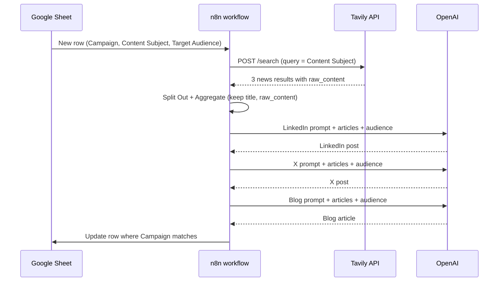

# Architecture

This document walks through the workflow node by node and shows how data changes shape along the way.

The workflow has 12 nodes: 9 on the main path and 3 OpenAI Chat Model sub-nodes, one attached to each agent.

## Data flow at a glance



## Stage 1: Research

### 1. Google Sheets Trigger

| Setting | Value |
| --- | --- |
| Event | Row added |
| Polling | Every minute |

Starts a run for each new row in the sheet. The row's columns become the item's JSON fields.

Output:

```json
{
  "Campaign": "AI in Healthcare – Q4",
  "Content Subject": "AI diagnostics in hospitals",
  "Target Audience": "Hospital administrators"
}
```

### 2. Set Search Fields

Maps the sheet's human-readable column names to two clean field names used by the rest of the workflow.

| Field | Expression |
| --- | --- |
| `query` | `{{ $json['Content Subject'] }}` |
| `targetAudience` | `{{ $json['Target Audience'] }}` |

Later nodes refer back to this node for the target audience, so the sheet's column names only need to be known in one place.

### 3. Search Internet

An HTTP Request node that calls Tavily.

```
POST https://api.tavily.com/search
```

```json
{
  "api_key": "YOUR_TAVILY_API_KEY",
  "query": "<Content Subject>",
  "search_depth": "basic",
  "include_answer": true,
  "topic": "news",
  "include_raw_content": true,
  "max_results": 3
}
```

| Parameter | Why |
| --- | --- |
| `topic: news` | Restricts results to recent news coverage |
| `include_raw_content: true` | Returns the full article text, not just a snippet |
| `max_results: 3` | Enough sources for variety while keeping the prompt size manageable |
| `search_depth: basic` | The faster, cheaper search tier |

The query expression escapes double quotes (`$json.query.replace(/"/g, '\\"')`) so a subject containing quotes does not break the JSON body.

Output: one item containing a `results` array of three objects, each with `title`, `url`, `content`, `raw_content`, `score` and so on.

### 4. Split Out

Splits the `results` array into three separate items, one per article.

### 5. Aggregate

Combines the three items back into one, keeping only `title` and `raw_content`.

Output:

```json
{
  "data": [
    { "title": "…", "raw_content": "…" },
    { "title": "…", "raw_content": "…" },
    { "title": "…", "raw_content": "…" }
  ]
}
```

The Split Out and Aggregate pair acts as a filter: it drops everything the agents do not need (URLs, scores, snippets) and hands them a single item.

## Stage 2: Content

All three agents are n8n AI Agent nodes of type **Conversational Agent**. Each has its own OpenAI Chat Model sub-node and no memory or tools attached, so each run is a single, stateless generation.

Every agent receives the same user message:

```
Article Content:
<the aggregated articles as a JSON string>

Target Audience:
<targetAudience from Set Search Fields>
```

What differs is the system prompt. See [PROMPTS.md](PROMPTS.md) for the full prompts.

### 6. LinkedIn

Writes a LinkedIn post: plain text, frequent line breaks, 1–2 emojis, a call to action, 3–5 hashtags, under 3,000 characters.

### 7. X

Writes a post for X within 280 characters, with 1–2 emojis, a call to action and 1–3 hashtags.

### 8. Blog Writer

Writes a two-paragraph blog article in a professional but approachable tone.

### Why the agents are chained

The agents are connected in series (LinkedIn → X → Blog Writer), but none of them reads the previous agent's output. `X` and `Blog Writer` fetch the articles directly from the `Aggregate` node with `$('Aggregate').item.json.data`.

The chain exists so that by the time the run reaches `Update Campaign`, all three agents have executed and their outputs can be referenced by node name.

### 9. Update Campaign

A Google Sheets node in **update** mode.

| Column | Value |
| --- | --- |
| `Campaign` (match column) | `{{ $('Google Sheets Trigger').item.json.Campaign }}` |
| `LinkedIn` | `{{ $('LinkedIn').item.json.output }}` |
| `X` | `{{ $('X').item.json.output }}` |
| `Blog` | `{{ $('Blog Writer').item.json.output }}` |

It finds the row whose `Campaign` value matches the one that triggered the run and fills in the three content columns. `Content Subject` and `Target Audience` are left untouched.

Because the match is on `Campaign`, duplicate campaign names would cause the wrong row to be updated.

## Credentials used

| Node | Credential type |
| --- | --- |
| Google Sheets Trigger | Google Sheets Trigger OAuth2 |
| Update Campaign | Google Sheets OAuth2 |
| OpenAI Chat Model (×3) | OpenAI API |
| Search Internet | Tavily API key, set in the request body |
